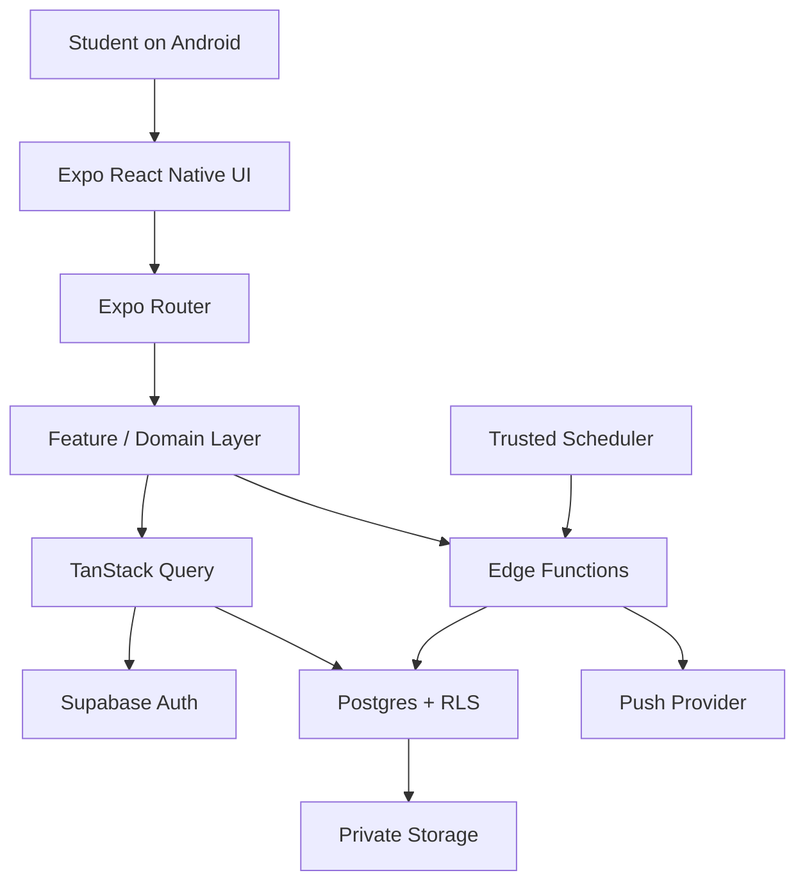

# MelBond — Architecture

## 1. Recommended stack
React Native + Expo + TypeScript, Expo Router, Supabase Auth/PostgreSQL/RLS/private Storage, Edge Functions and scheduled jobs as needed, TanStack Query, React Hook Form + Zod, Expo Notifications, EAS Build. Verify package compatibility with the selected Expo SDK before installing dependencies.

## 2. High-level flow

The client is untrusted. RLS and trusted server-side code enforce authorization.

## 3. Suggested structure
```text
MelBond/
├── AGENTS.md
├── PRD.md
├── app/
│   ├── _layout.tsx
│   ├── (auth)/
│   ├── (onboarding)/
│   ├── (tabs)/
│   └── projects/
├── src/
│   ├── components/
│   ├── features/{auth,projects,playbooks,tasks,milestones,meetings,decisions,resources,notifications,pulse,search}/
│   ├── lib/{supabase,validation,errors}/
│   ├── hooks/
│   ├── theme/
│   └── types/
├── supabase/{migrations,functions,seed.sql}
├── tests/
├── assets/
├── .env.example
└── package.json
```
Adapt to the chosen Expo template and record any structural decision.

## 4. Layers
1. Presentation: screens, accessible components, navigation, transient form state.
2. Feature/domain: task transitions, project rules, membership operations, use cases.
3. Data access: typed queries, query keys, mapping, normalized errors.
4. Trust boundary: RLS, database constraints, Edge Functions, scheduled jobs.
5. Integrations: push notifications, storage, external links.

## 5. Proposed data model
- `profiles`: user profile keyed to authenticated user ID.
- `projects`: owner, name/type, description, metadata, archive state, dates.
- `project_members`: project/user relationship, role, join time.
- `project_invitations`: project, invite target if applicable, token hash, expiry, redemption/revocation metadata.
- `project_phases`: project-scoped ordered phases.
- `milestones`: project, title/description, target date, status, progress mode.
- `tasks`: project, title/description, primary assignee, status/priority/dates, phase/milestone links, creator/updater.
- `task_collaborators`, `task_checklist_items`, `task_comments`.
- `meetings`, optional `meeting_availability_options`/`meeting_votes`, `meeting_minutes`.
- `decisions`: status, author/context, timestamps, supersedes link.
- `resources`: category, description, external URL or private storage path, optional milestone.
- `team_pulse_checkins`: project, user, period, state, optional blocker.
- `activity_events`: project, actor, event type, safe metadata, timestamp.
- `notification_preferences`, plus delivery/idempotency records where needed.

This is a proposal; settle cascade behavior, retention, constraints, indexes, and RLS before migrations.

## 6. Invariants
- Every project-owned record must be checked against its project boundary.
- Assignees/collaborators/authors must satisfy membership rules.
- Members cannot elevate their own role.
- Ownership cannot disappear without explicit transfer/deletion handling.
- Invitation redemption must be secure, expiring, revocable, and race-safe.
- Archived behavior is consistent across UI, RLS, and trusted operations.
- Storage paths are not authorization by themselves.
- Decision history is not silently overwritten.
- Scheduled notifications are idempotent and re-check access at delivery time.

## 7. Authentication and access
- Use Supabase Auth and safe session restoration.
- UI route guards improve UX; RLS protects data.
- Enable RLS on every user-accessible table and define grants with policies.
- Use `auth.uid()` and explicit membership checks.
- Service-role credentials stay server-side.
- Test ID substitution, cross-project reads/writes, and unauthorized file downloads.
- Invitation redemption uses a trusted server-side operation or constrained transaction; never trust client-supplied roles.

## 8. Data fetching
- TanStack Query manages remote state; component state manages transient UI state.
- Stable query keys scoped by user/project.
- Invalidate/update affected queries after mutations.
- Paginate tasks and activity.
- Clear user-scoped caches on sign-out/account switch to prevent data leakage.

## 9. Notifications
Local notifications are not enough for reliable team-wide reminders. Use trusted scheduled jobs, idempotency records, current membership/preference checks, safe payloads, token rotation handling, and retry logic. Document Android permission, battery, and network constraints.

## 10. Storage and links
Private bucket; explicit membership-based Storage policies; file size/type validation; safe filenames; short-lived signed URLs where appropriate. Validate external URL schemes and treat links as untrusted.

## 11. Errors and logs
Normalize errors into user-safe messages. Do not show raw DB errors/secrets/stack traces. Structured logs must exclude tokens and unnecessary private content. Track notification outcomes without creating surveillance.

## 12. Testing
- Unit: domain rules, date/overdue logic, progress.
- Component: forms, accessibility, loading/empty/error.
- Integration: data adapters and mutations.
- Security: RLS matrix, invitations, storage, cross-project isolation.
- E2E: auth, project/invite, tasks, meetings, decisions/resources, archive.
- Release: Android build and device smoke tests.
Use local Supabase for RLS/migration testing when possible; mark unavailable checks as blocked, not passed.

## 13. Decisions to resolve
Minimum Android version/Expo SDK; auth confirmation/reset; invite delivery; deletion/retention; file limits/types; timezone semantics; push provider/secrets; availability poll scope; activity retention/edit policy; offline-write support (default: no silent offline mutation queue).
